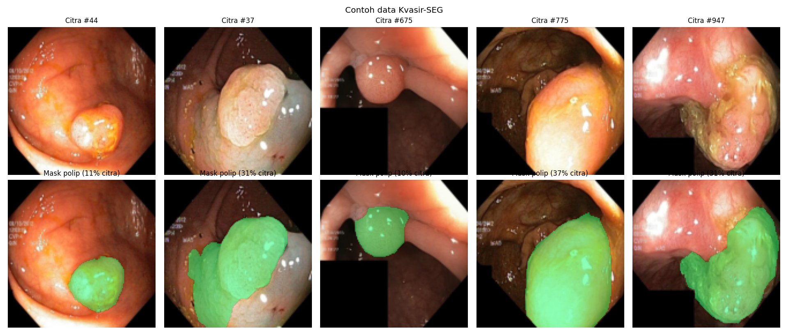
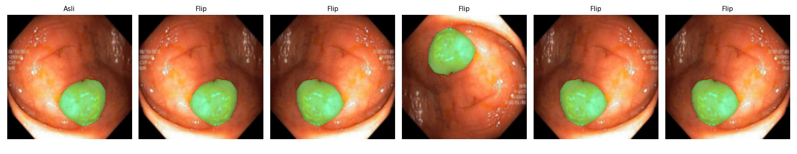
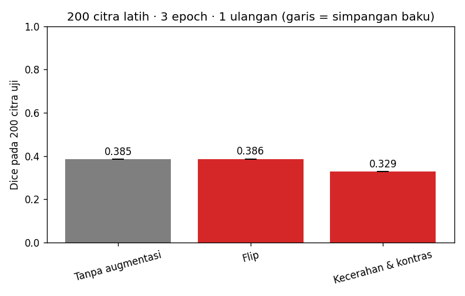
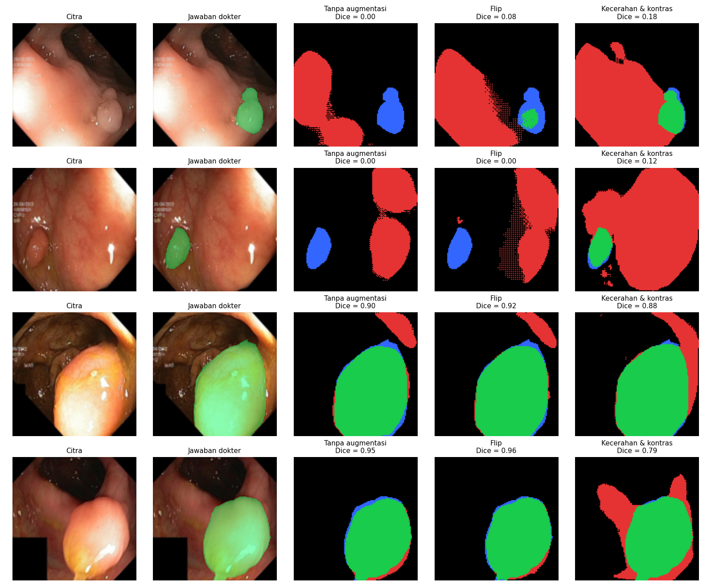

# Segmentasi Polip pada Citra Kolonoskopi dengan U-Net

**Tugas P10 — Kecerdasan Buatan (BM25-41204), Teknik Biomedis ITERA**

## Anggota kelompok

| Nama | NIM | Username GitHub | Kontribusi utama |
|---|---|---|---|
| Dwi Izzati Khairunnisa | 123430084 | dwikhrnssa19 | Ketua kelompok, setup repositori, menjalankan eksperimen final di Google Colab |
| Nahdia Shofi Rahayu | 123430100 | nahdia100 | Analisis hasil metrik & visualisasi peta kesalahan (Bagian 4 & 5) |
| Yaumil Adhha | 123430020 | yaumil123430020-prog | Uji coba awal, perancangan skenario & hipotesis, penyusunan pembahasan & kesimpulan (Bagian 3, 6–8) |

## 1. Pertanyaan

Augmentasi apa yang membantu U-Net menemukan polip pada citra kolonoskopi, dan augmentasi apa yang tidak? Kenapa?

## 2. Data & pengaturan

- Dataset: Kvasir-SEG (1000 citra kolonoskopi + mask polip), diperkecil ke 128 × 128 piksel.
- Data uji: 200 citra (tetap). Data latih: 200 citra per ulangan.
- Model: U-Net mini (±0,5 juta parameter), 40 epoch, 3 ulangan per skenario.
- Dijalankan di: Google Colab T4 GPU.



## 3. Skenario augmentasi & hipotesis

| Skenario | Augmentasi (kode) | Alasan klinis | Hipotesis: Dice naik/turun/sama? |
|---|---|---|---|
| Tanpa augmentasi | — | Pembanding | — |
| Saturasi | `v2.ColorJitter(saturation=0.3)` | Warna tidak boleh terlalu pucat/pekat supaya mudah dideteksi dan disegmentasi | Dice naik |
| Flip | `v2.Compose([v2.RandomHorizontalFlip(), v2.RandomVerticalFlip()])` | Orientasi tampilan polip dapat berbeda akibat perubahan posisi dan arah kamera kolonoskop selama pemeriksaan. | Dice diperkirakan naik karena model belajar mengenali polip dari berbagai orientasi citra. |

Contoh augmentasi yang dicoba:



## 4. Hasil

| Skenario | Dice (rata-rata ± sb) | IoU (rata-rata ± sb) | Dice tiap ulangan |
|---|---|---|---|
| Tanpa augmentasi | 0.487 ± 0.066 | 0.377 ± 0.052 | 0.408, 0.571, 0.481 |
| Saturasi | 0.571 ± 0.047 | 0.463 ± 0.039 | 0.630, 0.514, 0.569 |
| Flip | 0.649 ± 0.022 | 0.536 ± 0.024 | 0.621, 0.675, 0.650 |



## 5. Analisis peta kesalahan



Berdasarkan visualisasi 4 contoh citra uji pada peta kesalahan (hijau = *true positive* / prediksi benar, merah = *false positive* / area non-polip yang keliru diprediksi sebagai polip, biru = *false negative* / bagian polip asli yang terlewat):

- **Kasus polip yang sering terlewat (*false negative* / area biru):** Pada dua baris teratas, polip berukuran besar dengan permukaan berlekuk-lekuk dan warna yang sangat menyatu dengan mukosa usus (baik yang pucat kemerahan pada baris ke-1 maupun yang kekuningan menyerupai lipatan dinding usus pada baris ke-2) gagal total dideteksi oleh model *Tanpa augmentasi* (`Dice = 0.00`, seluruh area tertutup warna biru). Bentuk polip yang tidak beraturan dan menyebar luas membuat model tanpa augmentasi tidak mengenalinya sebagai massa polip.
- **Area non-polip yang sering keliru dideteksi (*false positive* / area merah):** Pada baris ke-3 (polip bertangkai kemerahan), area merah muncul di bagian kanan bawah pada skenario *Saturasi* (`Dice = 0.83`) dan *Flip* (`Dice = 0.90`). Bagian lipatan mukosa atau pangkal tangkai yang berbatasan langsung dengan polip ikut terdeteksi sebagai polip karena memiliki gradasi warna dan pencahayaan yang serupa. Sementara itu, pada baris ke-4 (polip bulat berbatas tegas), semua model mampu mensegmentasi dengan sangat akurat (`Dice = 0.94–0.96`) dengan hanya sedikit kesalahan tipis di tepi batas polip.
- **Apakah augmentasi memperbaiki kasus sulit?** Ya, secara signifikan. Pada kasus sulit di baris ke-1 dan ke-2 yang sebelumnya bernilai `Dice = 0.00`, penambahan augmentasi **Saturasi** berhasil mengangkat skor menjadi `0.61` dan `0.33`, sementara augmentasi **Flip** mengangkatnya menjadi `0.34` dan `0.40` (muncul area prediksi hijau di bagian tengah massa polip). Hal ini menunjukkan bahwa variasi warna (*Saturasi*) membantu model membedakan tekstur polip yang warnanya mirip mukosa usus, sedangkan variasi orientasi (*Flip*) membantu mengenali polip dengan morfologi memanjang/miring, meskipun kadang sedikit memperlebar area tepi (*false positive*) pada polip bertangkai seperti di baris ke-3.

## 6. Pembahasan & kesimpulan

### Perbandingan Hasil dengan Hipotesis
Kedua hipotesis yang dirumuskan pada Bagian 3 **terbukti benar**, karena kedua skenario augmentasi berhasil meningkatkan rata-rata skor Dice maupun IoU dibandingkan pembanding **Tanpa augmentasi** (`0.487 ± 0.066`):
1. **Augmentasi Flip (`0.649 ± 0.022`, IoU `0.536 ± 0.024`):** Memberikan peningkatan performa tertinggi sebesar **+0.162 poin Dice** dibandingkan tanpa augmentasi. Selisih kenaikan ini jauh melampaui simpangan baku kedua skenario (`0.066` dan `0.022`), sehingga peningkatannya konsisten dan bermakna secara statistik. Selain itu, simpangan baku yang menyusut dari `0.066` menjadi `0.022` menunjukkan bahwa pelatihan model menjadi jauh lebih stabil antar-ulangan. Secara klinis, kamera kolonoskop masuk dan berputar di dalam lumen usus besar dari berbagai sudut; pembalikan horizontal dan vertikal memberikan variasi orientasi yang realistis tanpa merusak bentuk anatomis jaringan polip.
2. **Augmentasi Saturasi (`0.571 ± 0.047`, IoU `0.463 ± 0.039`):** Meningkatkan rata-rata skor Dice sebesar **+0.084 poin** dibandingkan tanpa augmentasi. Seperti terlihat pada analisis peta kesalahan, variasi saturasi membantu U-Net mendeteksi polip besar bertekstur lipatan yang warnanya menyatu dengan mukosa usus (yang sebelumnya bernilai `Dice = 0.00` pada model tanpa augmentasi). Namun, peningkatannya tidak setinggi Flip karena perubahan kejenuhan warna tidak menambah variasi bentuk spasial polip dan sedikit memperlebar area tepi (*false positive*) pada polip bertangkai.

### Kesimpulan
Augmentasi geometris berupa **Flip (horizontal dan vertikal)** terbukti paling efektif membantu U-Net mensegmentasi polip pada citra kolonoskopi karena sesuai dengan variasi orientasi sudut pandang kamera endoskopi dan menghasilkan prediksi yang stabil. Augmentasi **Saturasi** juga bermanfaat untuk membantu model mengenali polip dengan warna yang menyatu dengan dinding usus, namun perannya paling optimal bila digunakan sebagai pelengkap augmentasi geometris.

## 7. Pembagian kerja

- **Dwi Izzati Khairunnisa (`dwikhrnssa19`):** Membuat repositori publik GitHub, mengundang kolaborator, menjalankan eksperimen akhir (`CEPAT = False`) di Google Colab T4 GPU, serta mengunggah output notebook dan folder `hasil/` ke repositori.
- **Nahdia Shofi Rahayu (`nahdia100`):** Mengolah tabel metrik evaluasi (Dice & IoU) dari `ringkasan.md` dan menyusun analisis visualisasi peta kesalahan (Bagian 4 dan Bagian 5).
- **Yaumil Adhha (`yaumil123430020-prog`):** Melakukan uji coba awal notebook, menyusun skenario augmentasi dan hipotesis klinis (Bagian 3), serta menulis pembahasan, kesimpulan, dan finalisasi laporan (Bagian 6–8).

## 8. Penggunaan AI

Gemini digunakan untuk membantu memahami alur kerja Git dan Google Colab, menyusun analisis perbandingan metrik dan peta kesalahan, serta merapikan tata bahasa pada bagian pembahasan dan kesimpulan laporan di `README.md`.

## Cara menjalankan ulang

```bash
uv sync
uv run jupyter lab segmentasi_polip.ipynb

Atau buka notebook di Google Colab (Runtime → Change runtime type → T4 GPU).

## Referensi
- Jha, D., dkk. (2020). Kvasir-SEG: A Segmented Polyp Dataset. MultiMedia Modeling (MMM 2020), 451–462.
- Ronneberger, O., Fischer, P., & Brox, T. (2015). U-Net: Convolutional Networks for Biomedical Image Segmentation. MICCAI. arXiv:1505.04597.